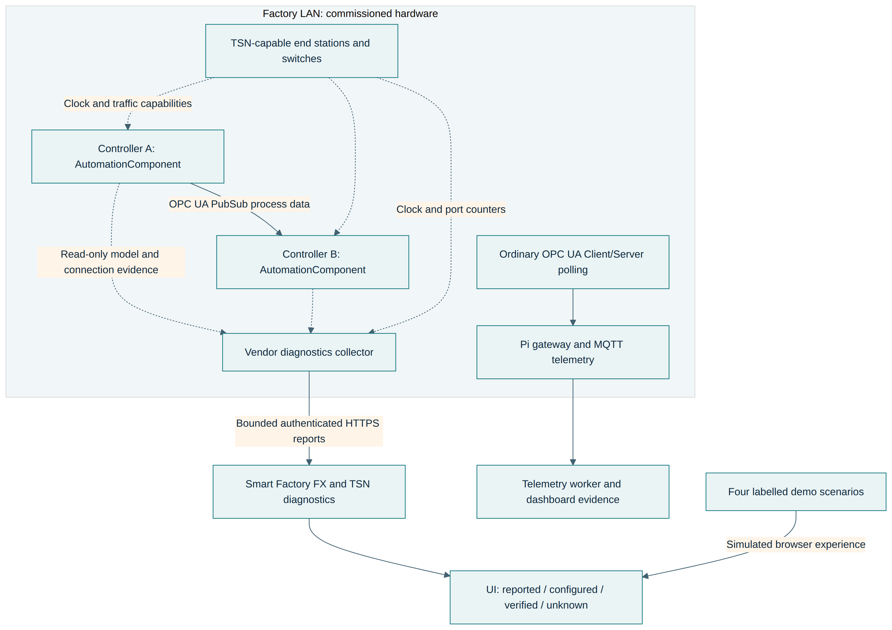

# System diagrams

Maintained diagrams live with their explanations in the canonical guides. The SVG and PNG exports are generated from those same Mermaid sources by `pnpm docs:pdf`.

| Guide | Diagram downloads | Scope |
|---|---|---|
| [Architecture](docs/architecture.md) | [SVG](docs/diagrams/architecture.svg) · [PNG](docs/diagrams/architecture.png) | Vercel UI, Oracle ARM64 API, singleton worker, managed services and factory edge boundaries. |
| [OPC UA FX and TSN](docs/fx-tsn.md) | [SVG](docs/diagrams/fx-tsn.svg) · [PNG](docs/diagrams/fx-tsn.png) | Local controller communication, Ethernet timing and read-only cloud diagnostics; separate polling/MQTT telemetry. |
| [Connected Pi 5 and DHT11 bench](docs/pi-dht11-bench.md) | [SVG](docs/diagrams/pi-dht11-bench.svg) · [PNG](docs/diagrams/pi-dht11-bench.png) | Observed DHT11 → WROVER → Pi gateway → cloud telemetry route and the unverified Live/FX/TSN boundary. |
| [API flows](docs/api-flows.md) | [PDF](docs/api-flows.pdf) | Authentication, AAS workflows, Assistant, layouts, sandbox and diagnostics. |
| [Database schema](docs/database-schema.md) | [PDF](docs/database-schema.pdf) | Persisted entities, observations, diagnostics retention and versioned factory layouts. |

The [30 October screenshot gallery](docs/evidence/release-20261030/README.md) records the released light/dark/mobile factory, equipment graphics and FX/TSN demonstration. Dated older galleries remain historical evidence.

Use the [Oracle/Vercel deployment runbook](deploy/oracle/README.md) for qualification, API-first release and rollback. Kubernetes and Render configurations remain historical references outside the supported production release.
