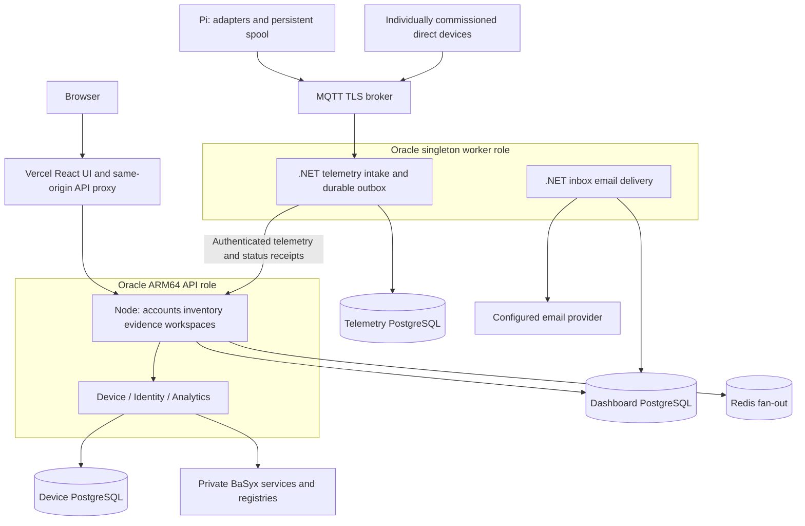

# Smart Factory IoT Architecture

Maintained 27 October 2026 for the product-experience candidate. Exact runtime and qualification identities are separate from this architecture description.

## Repositories and ownership

| Repository | Responsibility |
|---|---|
| smart-factory-iot-frontend | React UI, Express/tRPC accounts and session authority, shared PostgreSQL inventory, AAS workflows, evidence policy, native 3D, native OT security, incidents, inbox and optional Onesa export |
| smart-factory-iot-backend | .NET 10 LTS Device, Telemetry, Identity, Analytics and Notification services; durable telemetry outbox; private AAS provisioning and scoped command interfaces |
| smart-factory-iot-edge | Raspberry Pi protocol adapters, validated routes/units, persistent MQTT spool, commissioned controls and ESP32 firmware |

Native 3D and cybersecurity work without Onesa, external feeds or an LLM. The existing detailed model is an illustrative reference, not validated plant CAD. Component evidence requires an explicit component/source link; a parent value is not copied to every part.

## Deployment and data flow

The same non-root backend image runs four API processes and two worker processes, selected by the compatibility variable `RENDER_SERVICE_ROLE`. Production uses the existing Oracle Compose stack; the historical variable name does not imply Render hosting. The worker remains single-instance. Managed PostgreSQL, Redis and MQTT and the private BaSyx/Caddy stack retain their existing providers. The React UI is a separate static Vercel artifact.

The [Oracle runbook](../deploy/oracle/README.md) owns deployment, image identity, additive migrations, API-first ordering and rollback. Independent Vercel Git deployment for main remains disabled. The legacy Render workflow stays gated off. Repository protection is inspected independently and is not implied by a workflow.

## Identity, scope and evidence

The Node API checks bcrypt passwords and issues eight-hour HttpOnly cookie sessions. Protected requests reload current role, disabled state, session generation, recovery restriction and revocation. Sockets retain identity and expiry; delegated .NET routes independently enforce the persisted session. Unsafe cookie requests enforce exact allowed origins. Secrets never enter browser state or published profiles.

Individually authenticated operational roles apply on private installations. Shared demo identities and public-demo deployments are read-only and limited to explicitly approved fixtures. Central actor checks run before writes and publishers. Raw HTTP, exports, downloads and delegated services follow the same boundary. Fixture targets remain read-only for individual users too. The [access guide](access-and-publication.md) documents bootstrap, recovery, disable/revoke and public passport publication.

Assets, independent devices, gateways and equipment share one typed inventory. AAS, source, gateway and representation links are explicit and separate. Registration saves identity and software configuration; broker credentials, profile application and physical commissioning are distinct outcomes. Incoming samples never rewrite commissioned topology or automatically create operational inventory.

Telemetry retains acquisition and receipt time, mode, quality, source units, canonical conversion evidence and observed route. Scope is applied before latest sample selection or SQL aggregation. Explicit live mode is subject to source-specific quality, retained-delivery, lateness, clock-skew and monotonic-state policy before changing current status or threshold incidents. Historical evidence stays inspectable. Unknown legacy units remain unknown; unknown-unit thresholds require review.

Process incidents retain initial/latest evidence snapshots and append-only review activity. Offline connectivity does not automatically establish confirmed factory downtime. Cybersecurity owns separate findings and investigation histories; unobserved collectors remain unknown, and zero findings is not a security certificate.

## Representation and integrations

AAS provisioning and package import preserve vendor documents, revisions, concepts and files. Dashboard-managed writes cannot bypass revision history through the standards gateway. AAS OAuth service credentials do not provide user SSO. See [authorization and AAS](authorization-and-aas.md) and [API flows](api-flows.md).

The Assistant reads only approved current guides and a bounded authorized evidence snapshot. It uses the same visibility and units policy and links to actual items/incidents. Local fallback remains available. It cannot control equipment or infer a physical cause from a threshold observation. Optional external-provider use is separately configured; UI qualification uses no provider.

Public passports default to private preview. Authorized publication snapshots only selected reviewed fields and asset-appropriate guidance under a revocable public identity. Numeric asset IDs grant no public access. Onesa remains an optional versioned export with distinct external-consumer acceptance.

## Operations and acceptance

The runtime contract checks build source identities, required capabilities and applied migration hashes. UI compatibility checks occur before authenticated workflows. Promotion additionally requires a recent compatible singleton-worker receipt, exact schema compatibility and a final current-main check after building. A ready API alone establishes none of these contracts and does not establish physical equipment availability.

Accepted telemetry survives restart in the independent worker outbox; the edge persists before MQTT publication and removes entries only after broker acknowledgement. Duplicate deliveries do not create duplicate current effects. Operating evidence shows backlog depth and oldest known queue acceptance, quarantine/rejections, collector receipt times and email failures. Missing/stale worker receipts mean current queue state is unknown. Provider acceptance does not prove mailbox delivery. Backup age remains unknown without verified evidence.

Analytics uses complete-range SQL summaries and bounded buckets with visible gaps, with separately bounded/paginated details and explicit completeness metadata. Polling pauses hidden/offline work, backs off stale sources and retains a bounded authorized fast mode. The primary database connection budget remains unchanged.

Demonstration fixtures are seeded only by an explicit CLI in guarded disposable storage. Viewing and startup never seed. Recorded simulations retain their source mode and period; disconnected physical commissioning examples remain separate. Physical commissioning, hardware performance, external Onesa consumer acceptance and production promotion are separately named outcomes. See [operations](operations.md).
