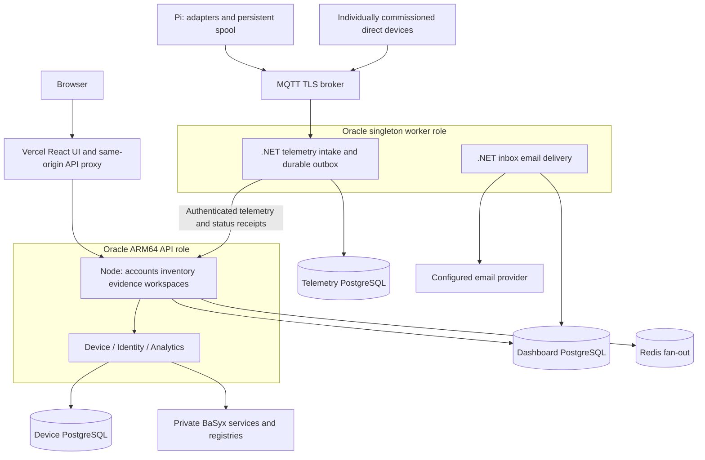

# Smart Factory Architecture

Updated 31 October 2026 for the connected Pi/DHT11 bench, account requests, factory layout, Assistant, demo sandbox and FX/TSN experience. Exact runtime and qualification identities are separate from this architecture description.

## Repositories and ownership

| Repository | Responsibility |
|---|---|
| smart-factory-frontend | React UI, Express/tRPC accounts and session authority, shared PostgreSQL inventory, AAS workflows, evidence policy, native 3D, native OT security, incidents, inbox and optional Onesa export |
| smart-factory-backend | .NET 10 LTS Device, Telemetry, Identity, Analytics and Notification services; durable telemetry outbox; private AAS provisioning and scoped command interfaces |
| smart-factory-edge | Raspberry Pi protocol adapters, validated routes/units, persistent MQTT spool, commissioned controls and ESP32 firmware |

Native 3D and cybersecurity work without Onesa, external feeds or an LLM. The existing detailed model is an illustrative reference, not validated plant CAD. Component evidence requires an explicit component/source link; a parent value is not copied to every part.

## Deployment and data flow

The same non-root backend image runs four API processes and two worker processes, selected by the compatibility variable `RENDER_SERVICE_ROLE`. Production uses the existing Oracle Compose stack; the historical variable name does not imply Render hosting. The worker remains single-instance. Managed PostgreSQL, Redis and MQTT and the private BaSyx/Caddy stack retain their existing providers. The React UI is a separate static Vercel artifact.

The [Oracle runbook](../deploy/oracle/README.md) owns deployment, image identity, additive migrations, API-first ordering and rollback. Independent Vercel Git deployment for main remains disabled. The legacy Render workflow stays gated off. Repository protection is inspected independently and is not implied by a workflow.

## Identity, scope and evidence

The Node API checks bcrypt passwords and issues eight-hour HttpOnly cookie sessions. Protected requests reload current role, disabled state, session generation, recovery restriction and revocation. Sockets retain identity and expiry; delegated .NET routes independently enforce the persisted session. Unsafe cookie requests enforce exact allowed origins. Secrets never enter browser state or published profiles.

Public registration and password-recovery requests are rate limited. A pending registration cannot sign in. An individual administrator verifies the applicant, chooses Viewer, Operator, Engineer or Admin, and approves or rejects the request. Password recovery uses an expiring, single-use email link when delivery is configured; the database stores only its token hash and an encrypted delivery payload. The existing mail worker sends the link using its configured provider and recipient policy. An administrator can also verify identity and issue a temporary credential through an approved private channel. Shared demo administrators cannot review account requests. See [account access](account-access.md).

Approved individual accounts retain their role-scoped operational access when they select Live, including on an origin that also offers shared demo accounts. Reserved demo identities and individuals selecting Demo read only approved demonstration records. Their editable sandbox stores simulated changes in the browser; it does not write operational inventory or shared fixtures. Central actor checks run before writes and publishers. Raw HTTP, exports, downloads and delegated services follow the same identity and workspace boundary. Fixture targets remain read-only for individual users too. The [access guide](access-and-publication.md) documents bootstrap, recovery, disable/revoke and public passport publication.

Assets, independent devices, gateways and equipment share one typed inventory. AAS, source, gateway and representation links are explicit and separate. Registration saves identity and software configuration; broker credentials, profile application and physical commissioning are distinct outcomes. Incoming samples never rewrite commissioned topology or automatically create operational inventory.

Telemetry retains acquisition and receipt time, mode, quality, source units, canonical conversion evidence and observed route. Scope is applied before latest sample selection or SQL aggregation. Explicit live mode is subject to source-specific quality, retained-delivery, lateness, clock-skew and monotonic-state policy before changing current status or threshold incidents. Historical evidence stays inspectable. Unknown legacy units remain unknown; unknown-unit thresholds require review.

Process incidents retain initial/latest evidence snapshots and append-only review activity. Offline connectivity does not automatically establish confirmed factory downtime. Cybersecurity owns separate findings and investigation histories; unobserved collectors remain unknown, and zero findings is not a security certificate.

## Representation and integrations

AAS provisioning and package import preserve vendor documents, revisions, concepts and files. Dashboard-managed writes cannot bypass revision history through the standards gateway. AAS OAuth service credentials do not provide user SSO. See [authorization and AAS](authorization-and-aas.md) and [API flows](api-flows.md).

The Assistant reads only approved current guides and a bounded authorized evidence snapshot. It uses the same visibility and units policy and links to actual items/incidents. Local fallback remains available. It cannot control equipment or infer a physical cause from a threshold observation. Optional external-provider use is separately configured; UI qualification uses no provider.

Public passports default to private preview. Authorized publication snapshots only selected reviewed fields and asset-appropriate guidance under a revocable public identity. Numeric asset IDs grant no public access. Onesa remains an optional versioned export with distinct external-consumer acceptance.

## Named factories, layouts, demonstration and industrial diagnostics

Named factories link measured placements to the canonical assets/devices/equipment records. Engineer/Admin create factories and add inventory; Admin confirms inventory deletion. The team shares saved versions under existing permissions. Atomic database triggers retain attributed factory, inventory, connection and workflow changes in append-only activity. Shared demo identities use a resettable browser adapter. See [named factories](named-factories.md).

The complete authorized floor loads automatically in 3D, with seven illustrative reference-model families and an accessible plan fallback. Original material groups, environment reflections, surface finishes and adaptive shadows improve equipment readability. Geometry represents equipment types; it is not surveyed plant CAD or proof of installed hardware.

Users grab an item to move its layout position and grab empty floor to pan. Space pans over items; right-drag or Shift-drag rotates; scrolling/pinching zooms. Fullscreen retains the scene and placement. Layouts record floor dimensions, zones, positions and rotations. Individual accounts save versioned, scoped layouts with stale-save protection; demo drafts and simulated edits remain browser-local. See [factory layouts](factory-layouts.md), [editable sandbox](editable-demo.md) and [current screenshots](evidence/release-20261030/README.md).

OPC UA FX describes interoperable AutomationComponents, FunctionalEntities and logical connections, with OPC UA PubSub process-data exchange. TSN provides profile-dependent Ethernet timing and traffic capabilities. **Operations → FX & TSN** shows bounded reported diagnostics and four labelled demo scenarios; missing or stale timing stays unknown. A commissioned collector or authorized manual import supplies reports. The dashboard does not configure controllers or network schedules, carry the local control loop, or certify deterministic delivery. Existing OPC UA polling and MQTT ingestion remain separate telemetry paths. See the [FX/TSN guide and diagram](fx-tsn.md).

Digital passports support printing the reviewed public reference or a locally simulated demo passport. Operational publication still requires explicit authorization and selected-field review; private administration/deployment details stay outside public passports. See [access and publication](access-and-publication.md).

## Operations and acceptance

The runtime contract checks build source identities, required capabilities and applied migration hashes. UI compatibility checks occur before authenticated workflows. Promotion additionally requires a recent compatible singleton-worker receipt, exact schema compatibility and a final current-main check after building. A ready API alone establishes none of these contracts and does not establish physical equipment availability.

Accepted telemetry survives restart in the independent worker outbox; the edge persists before MQTT publication and removes entries only after broker acknowledgement. Duplicate deliveries do not create duplicate current effects. Operating evidence shows backlog depth and oldest known queue acceptance, quarantine/rejections, collector receipt times and email failures. Missing/stale worker receipts mean current queue state is unknown. Provider acceptance does not prove mailbox delivery. Backup age remains unknown without verified evidence.

Analytics uses complete-range SQL summaries and bounded buckets with visible gaps, with separately bounded/paginated details and explicit completeness metadata. Polling pauses hidden/offline work, backs off stale sources and retains a bounded authorized fast mode. The primary database connection budget remains unchanged.

Only an explicit CLI seeds demonstration fixtures in guarded disposable storage. Viewing never seeds. Simulations retain their source mode; physical examples remain separate. Physical commissioning, hardware performance, Onesa acceptance and production promotion require separate evidence.
