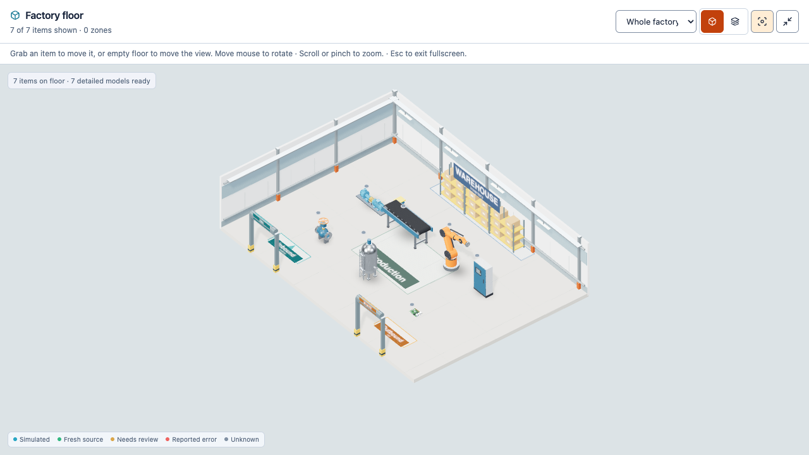
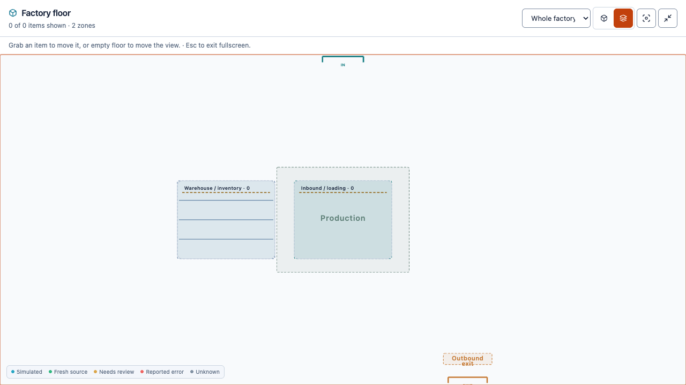

# Factory loading, storage and exit areas

These 30 October 2026 screenshots use an isolated browser fixture. The 3D example contains seven bundled illustrative reference models; architectural racks, cartons and doors do not create inventory or stock records. The plan example shows saved, named zones reopened in the same browser. Image hashes are retained in [the manifest](manifest.json).

Open **Tools & settings → Factory layouts**, add a zone and choose or type **Inbound / loading**, **Warehouse / inventory**, **Production / assembly** or **Outbound / dispatch**. Existing zone coordinates and dimensions control the matching feature. Doorways create openings in the nearest wall. Unconfigured purposes have reference context; the floor's registered-item counts remain scoped to authorized equipment.

Mouse movement over the 3D floor rotates the view without pressing. Holding an actual visible equipment surface pauses rotation and moves that item; nearby empty space pans the view. Labels, markers, shadows and selection rings do not enlarge equipment targets. See [the layout guide](../../factory-layouts.md) for controls and persistence.
