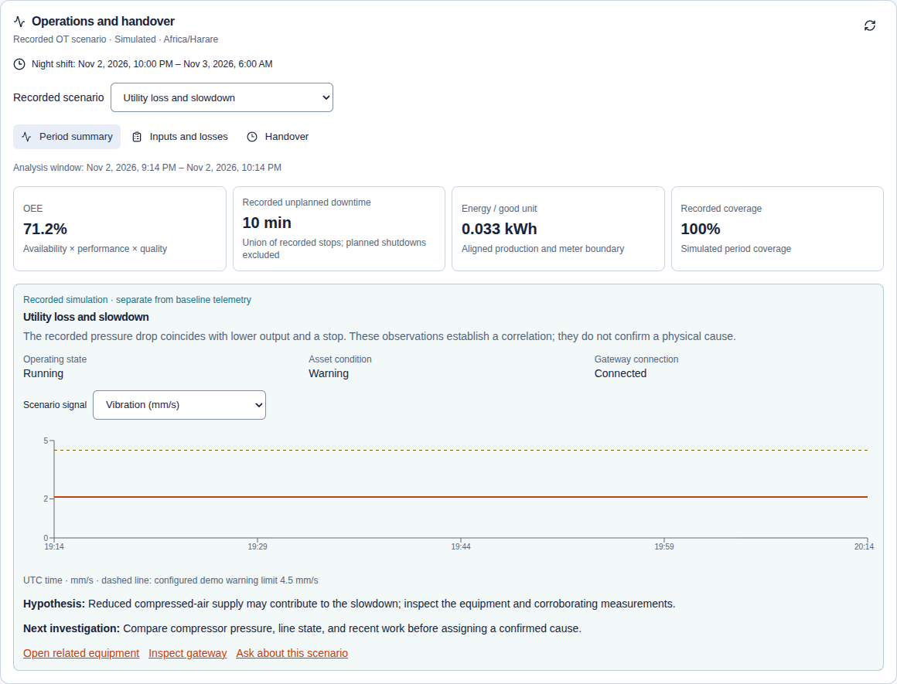
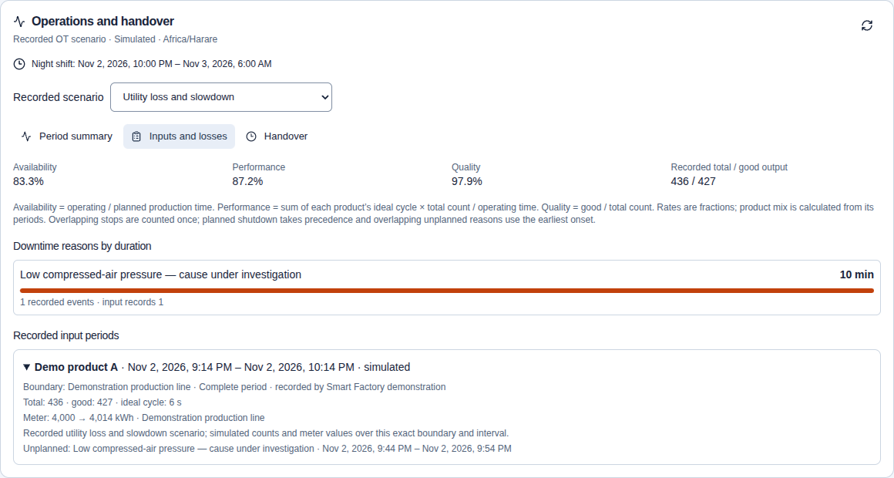
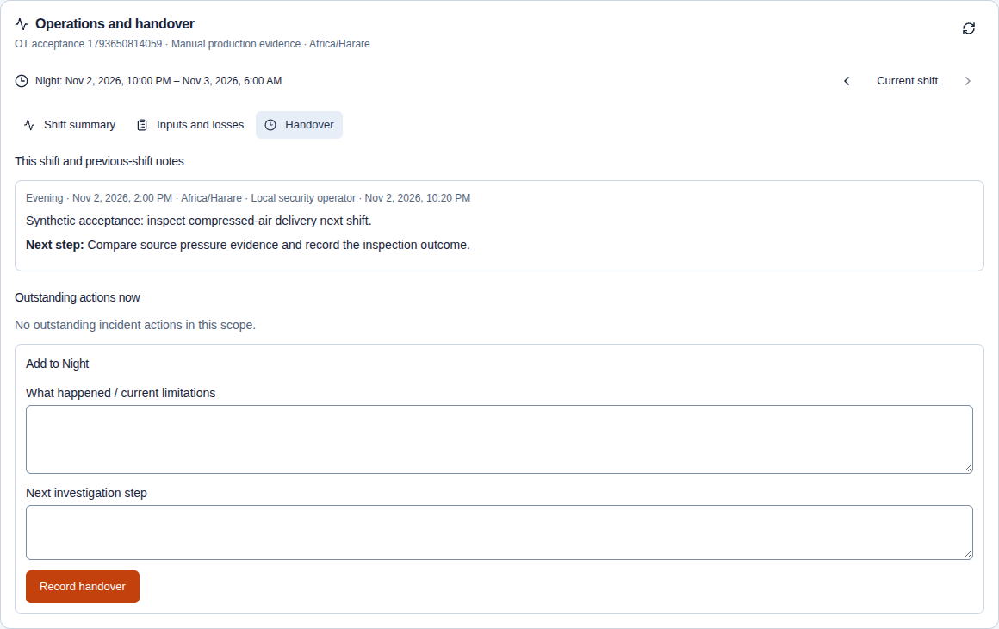
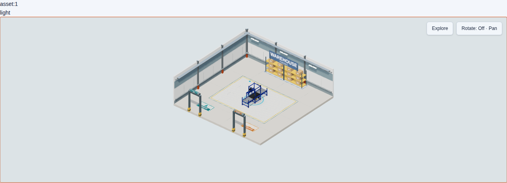

# OT workflow visual evidence — 2 November 2026

These images show the expanded candidate in an isolated local application with synthetic fixtures. They are not production screenshots. Chrome156 with SwiftShader rendered the views at1440px and390px; the scenario, time window, units and evidence mode remain visible. See the [qualification scope and limits](../../ot-operations-qualification.md).

## Operations and production

| View | Evidence |
| --- | --- |
| Desktop overview and factory | [Full page](desktop-utility-loss.png) · [Operations panel](desktop-utility-loss-operations.png) |
| Mobile overview and factory | [Full page](mobile-utility-loss.png) · [Operations panel](mobile-utility-loss-operations.png) |
| Production inputs and losses | [Desktop](analytics-desktop-inputs-operations.png) · [Mobile](analytics-mobile-inputs-operations.png) |
| Persisted prior-shift handover | [Desktop](live-prior-shift-handover-operations.png) · [Mobile](mobile-live-handover-operations.png) |

## Progressive floor rendering

The controlled single-conveyor fixture holds the lighting download, selects the visible local geometry, releases HDR/model delivery and verifies that selection remains attached to the same item. These fixture images establish that interaction is available before optional lighting, rather than a full-site loading time.

[Selectable preview](floor-selectable-preview.png) · [Detailed geometry and final lighting](floor-detailed-lighting.png) · [Dark exploration](floor-dark-exploration.png) · [Recorded timing](floor-timing.json)

