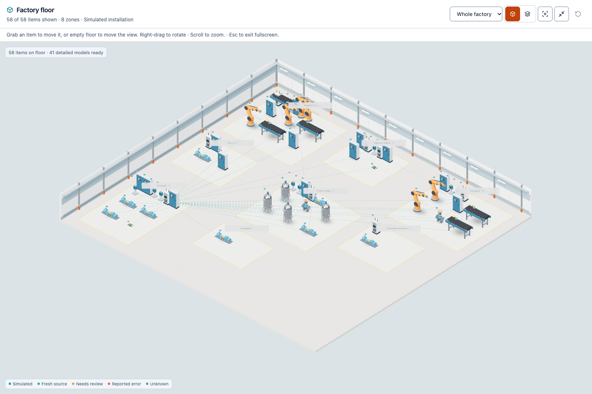
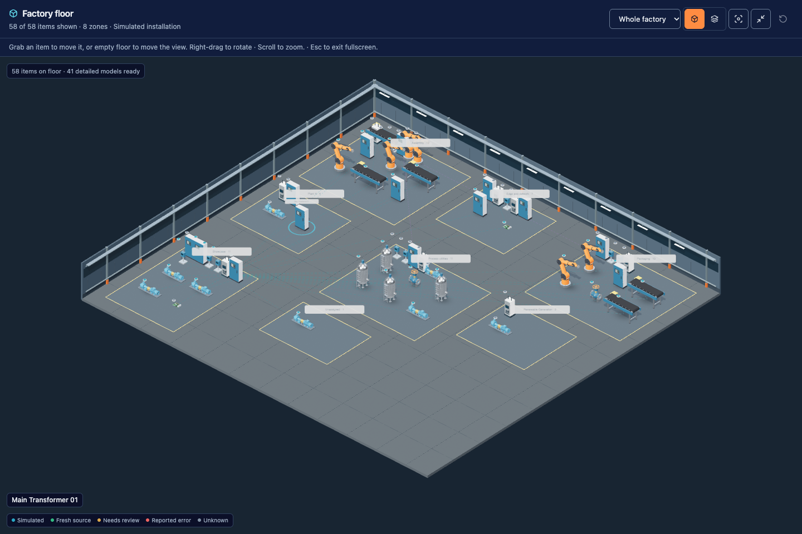
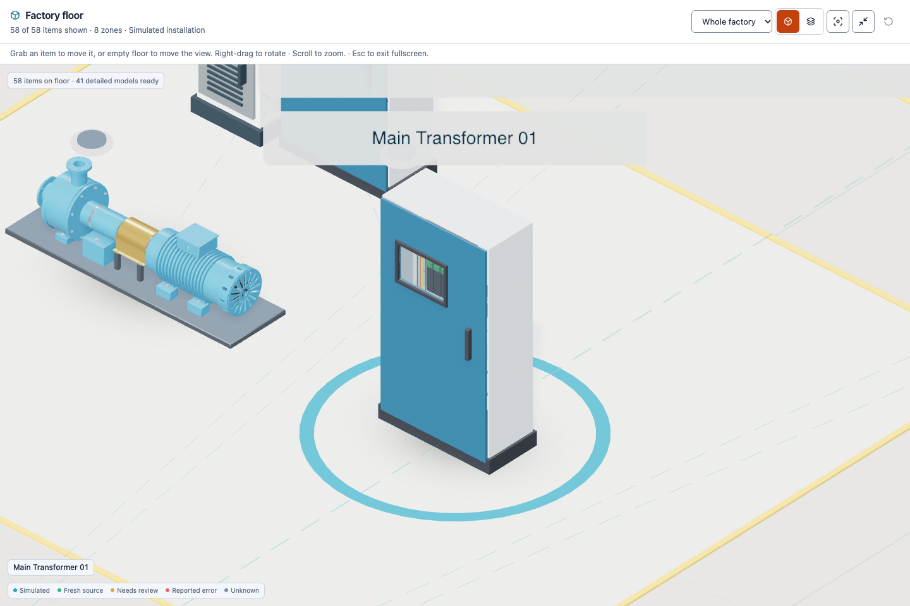
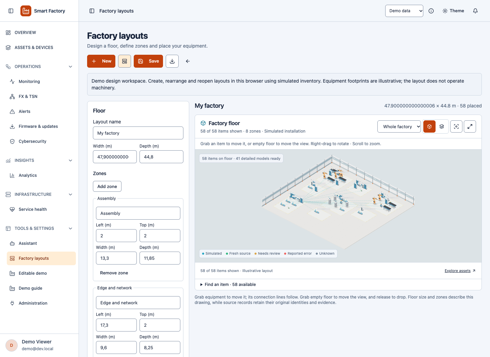
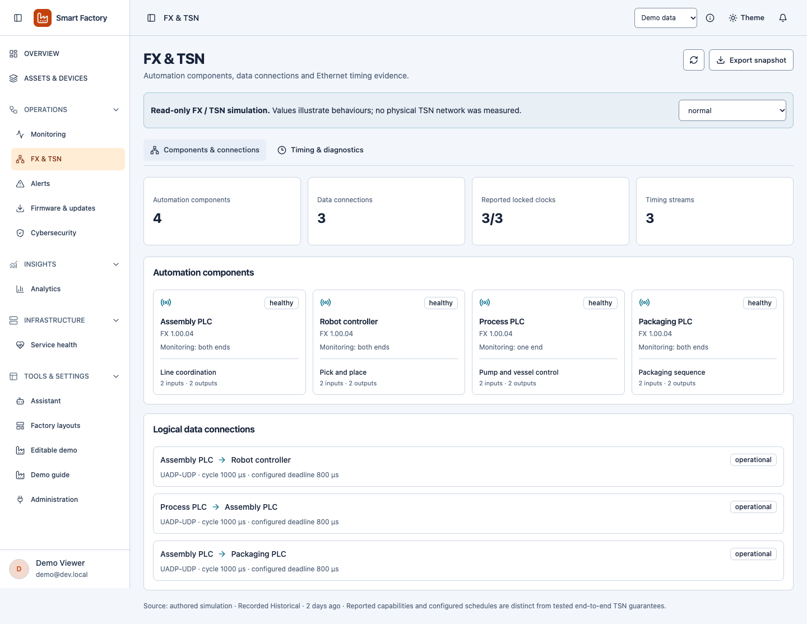
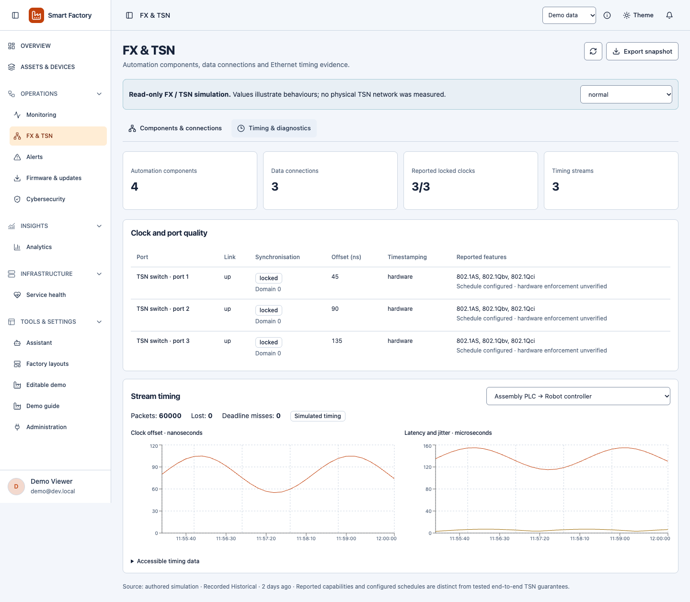
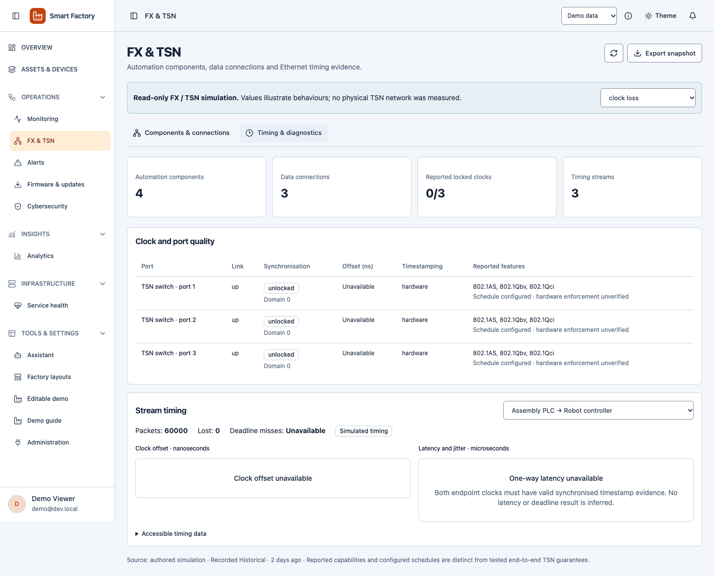

# Released factory and FX/TSN screenshot gallery

Captured from the production application on **30 October 2026**, frontend source `88a0e778fe5ea4d7adb45208d23fee4a9d28dc47`, at [Smart Factory](https://smart-factory-iot-app.vercel.app). These screenshots use the approved **Demo Viewer** and labelled simulated inventory. They contain no operational account or private deployment data. [Capture metadata](capture.json) records the new network/layout capture; [image hashes](manifest.json) cover the complete gallery.

The floor contains 58 approved items: 52 authored showcase items plus six retained legacy examples, across eight displayed zones. Seven reference-model families illustrate equipment; the shapes and positions do not establish installed CAD, physical condition or hardware timing. Older galleries remain evidence for their recorded revision.

## Factory, graphics and fullscreen

The released floor uses hand grabbing for items and empty-floor panning, compact accessible icons, retained original model materials, environment reflections and adaptive shadows. Fullscreen keeps the scene and positions. [Mouse, touch and keyboard controls](../../factory-layouts.md).

[Mobile fullscreen image](factory-mobile.png) shows the complete fit; pinch to zoom or double-click equipment for inspection.

## Create a factory layout

Name the floor, set dimensions, add zones and grab equipment into position. Individual accounts save scoped, versioned layouts. This screenshot shows a personal browser draft in the resettable demo; no shared inventory was edited. [Layout guide](../../factory-layouts.md) · [Editable sandbox](../../editable-demo.md).

## OPC UA FX and TSN

These are authored examples in **Operations → FX & TSN**, not measurements of a physical TSN installation. The workspace distinguishes reported clock/connection state, configured schedules and unverified hardware enforcement. [Concepts, diagram, reports and commissioning](../../fx-tsn.md).

## Other released workflows

- [Assistant](../../assistant.md) explains FX/TSN directly and resolves conversation follow-ups using approved guides and authorized context; local simulated snapshots stay local.
- [Digital passports](../../access-and-publication.md) can print an approved reference or locally simulated passport. Private deployment/administration records are not a public passport.
- [Editable demo](../../editable-demo.md) supports browser-local changes, reset and JSON backup/import while operational writes and real notifications retain their authorization checks.
- [Architecture](../../architecture.md) documents the Vercel UI and Oracle API/singleton worker. [System diagrams](../../../SYSTEM_DIAGRAMS.md) provides regenerated SVG/PNG downloads and four PDF guides.
