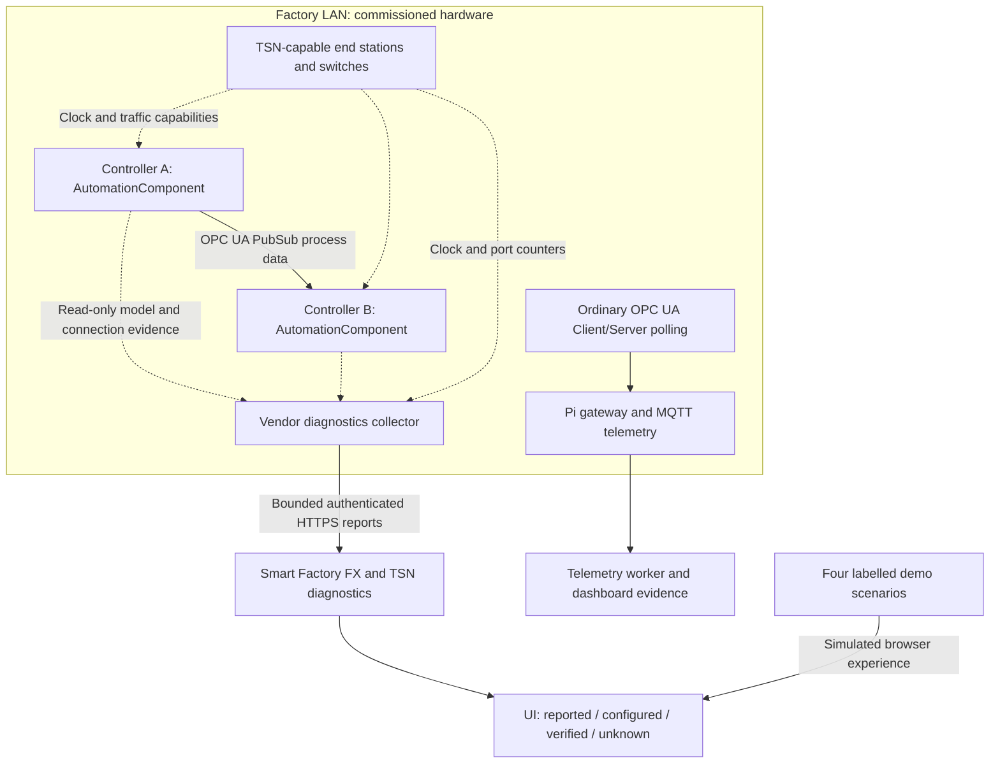

# OPC UA FX and TSN in Smart Factory

For the currently connected Raspberry Pi 5, ESP32 WROVER and DHT11 bench, see the [physical end-to-end test and capability boundary](pi-dht11-bench.md). Its MQTT sensor path is distinct from the FX/TSN diagnostic scenarios below.

OPC UA Field eXchange (UAFX) supplies an interoperable model for AutomationComponents, their FunctionalEntities and controller-to-controller connections. Current UAFX process-data exchange uses OPC UA PubSub. OPC UA Client/Server provides model access and configuration; ordinary polling of OPC UA variables is not itself an FX data connection. See [Part 81, connection communication](https://reference.opcfoundation.org/specs/OPC-10000-81/5.5.6.1) and the [AutomationComponent model](https://reference.opcfoundation.org/specs/OPC-10000-81).

Time-Sensitive Networking is a family of Ethernet capabilities. Time synchronization (802.1AS), scheduled traffic (802.1Qbv), frame preemption (802.1Qbu/802.3br), policing (802.1Qci) and redundancy (802.1CB) address different requirements. Support depends on the selected industrial profile and hardware. [IEC/IEEE 60802-2026](https://1.ieee802.org/tsn/iec-ieee-60802/) defines the industrial automation TSN profile. UAFX can also use best-effort or prioritized Ethernet; an FX model does not prove a deterministic network.

## Communication and monitoring boundaries

The diagram describes supported boundaries, not an installed controller network. FX data connections and TSN timing stay on the factory LAN. The cloud receives diagnostic summaries; the separate polling/MQTT path does not establish an FX connection or a hardware deadline. Download the [SVG](diagrams/fx-tsn.svg), [PNG](diagrams/fx-tsn.png) or [PDF guide](fx-tsn.pdf). See the [current workspace screenshot](evidence/release-20261030/README.md).

## Product workflow

Overview shows a complete factory floor with brief network indicators. Open **Operations → FX & TSN** for AutomationComponents, FunctionalEntities, logical PubSub connections, monitoring coverage, clock state/domain/grandmaster, timing graphs, packet loss and deadline results. Reported capabilities, configured schedules and verified hardware enforcement are separate fields.

Demo mode provides four explicitly authored scenarios: normal, late delivery, lost synchronization and recovery. Clock loss removes one-way latency and deadline claims rather than replacing unavailable values with zero. These examples do not configure a physical network or establish UAFX/TSN conformance.

An individual engineer can import a bounded diagnostics JSON snapshot, or a commissioned gateway can post the same schema to the authenticated collector endpoint. Each registered operational gateway retains its newest snapshot. Public demo sessions cannot import or modify reports. Export downloads the selected gateway snapshot for inspection and exchange. Retained reports older than two minutes are labelled stale; they do not assert current connection health.

## Commission a real installation

1. Inventory the actual PLCs, FX-capable controllers, NICs, switches and clock sources. Record supported UAFX models, PubSub transport and industrial TSN profile. Existing OPC UA polling and MQTT paths remain telemetry paths; they are not deterministic control loops.
2. Use the vendor's read-only model/discovery and diagnostics interface to collect AutomationComponent and FunctionalEntity identities, connection endpoints/states and monitoring coverage. Confirm both ends where the ConnectionManager does not monitor both. Map components to explicit registered device identifiers rather than names or inferred floor positions.
3. Collect switch/NIC counters and actual PTP/gPTP state from the supported local management interface. Keep the traffic schedule and control loop on the factory LAN. Publish bounded summaries to this application; never send every high-rate control packet to the cloud database.
4. Register the gateway in the operational inventory. For manual reports, use **Import snapshot**. For a service collector, provision a dedicated `NETWORK_DIAGNOSTICS_INGESTION_TOKEN` of at least 32 characters and comma-separated `NETWORK_DIAGNOSTICS_ALLOWED_GATEWAYS` in the existing API service environment. These are separate from telemetry credentials. The collector sends HTTPS `POST /api/internal/network-diagnostics`, `Authorization: Bearer <dedicated token>`, and `Content-Type: application/json`.
5. Validate real endpoint timing under representative competing traffic, clock loss and recovery before relying on any deadline. Hardware one-way latency requires distinct publisher/subscriber ports with locked hardware clocks in the same domain and grandmaster, plus actual synchronized timestamp evidence. A local timestamping capability or configured Linux schedule alone is insufficient.

The current delivery provides the monitoring UI, demo scenarios, validated import/export and collector ingestion contract. It does not implement a PLC FX connection manager, deploy PubSub control programs, configure Linux/switch schedules, or certify deterministic behavior. Use the equipment vendor's supported discovery/measurement collector to produce the report. No PLC or network write is performed by this feature.

## Report contract and retention

The authoritative validator is [shared/network-diagnostics.ts](../shared/network-diagnostics.ts). A version-1 snapshot contains `gatewayId`, UTC `observedAt`, provenance, components, connections, ports and streams. Reports are bounded to 128 components, 256 connections, 32 ports, 64 streams and 120 ordered samples per stream. Endpoints must omit embedded credentials, query strings and fragments. Stream and connection references must resolve within the report. Unknown values use `null` or an explicit unknown state.

The HTTP collector rejects uncommissioned credentials/gateway IDs, invalid reports and reports older than five minutes. Manual imports allow historical reports up to seven days and remain labelled operator imports. Future timestamps beyond five minutes and replacement by an older snapshot are rejected. The database stores one latest report per gateway, not a high-frequency packet history. The UI returns at most 128 gateway reports and explicitly reports any coverage limit.

Clock offset is displayed in nanoseconds; latency and jitter use microseconds. Software timing is identified separately. Missing one-way timing cannot assert a measured deadline result. Collector data is reported evidence rather than independent certification. See [LinuxPTP pmc](https://www.linuxptp.org/documentation/pmc/) and [ptp4l](https://www.linuxptp.org/documentation/ptp4l/) for actual local clock management/diagnostics; this application does not run their configuration commands.

## Release order

The API advertises `factory-floor-v1` and `fx-tsn-diagnostics-v1`. Qualify and deploy that API before the UI; the existing runtime gate rejects an older API. No schema migration or live collector credential is created automatically. Install the expanded demo with the separately invoked v4 showcase installer described in [the demonstration guide](complete-demonstration.md).
