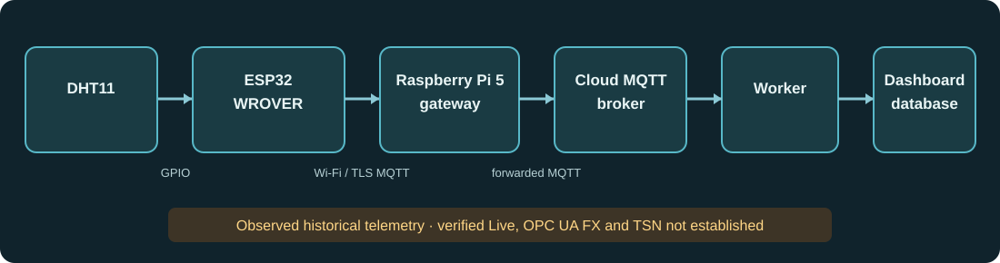

# Raspberry Pi 5 and DHT11 bench: physical test and limits

This is the tested hardware topology on 31 October 2026. The DHT11 is attached to the ESP32 WROVER, which publishes through the Raspberry Pi 5 gateway. The public browser demo contains an editable **Current Pi + DHT11 setup** floor with the same device roles and route. Its records are simulated and are separate from private physical telemetry. Board geometry is enlarged in 3D for inspection; floor positions are editable estimates until measured on site.

## End-to-end result at 02:37–02:38 UTC

- The Pi reported Raspberry Pi 5 Model B Rev 1.0. Its `smart-factory-edge`, Mosquitto and chrony services were active, and its clock was synchronized. The ESP32 resolved as `esp32-wrover-01.local` and established a TLS connection to the Pi broker on port 8883.
- The Pi logged successive allowlisted `esp32-wrover-01` telemetry messages. The cloud worker was subscribed with zero pending, quarantined or failed delivery attempts. The production dashboard database stored successive physical DHT11 readings at approximately five-second intervals, including 18.2 °C / 59% at 02:37:24 UTC and 18.3 °C / 53% at 02:37:49 UTC. This establishes the observed **sensor → ESP32 → Pi → cloud broker → worker → dashboard database** path at those times.
- Both operational device records lacked a reviewed commissioning policy. Their `lastSeen` values remained at 20 October even while new readings were stored. The newest reading's evidence reason was `not_commissioned`; gateway heartbeat observations reported `route_not_commissioned`.
- The production worker was explicitly set to `MqttProtocolVersion=3.1.1-historical`. A separate short-lived TLS MQTT 5 probe with a unique client ID received a CONNACK code 1 on the configured CloudAMQP TLS MQTT port 8883; it did not publish. The authenticated CloudAMQP console identifies **smart-factory-mqttbroker as LavinMQ**. [LavinMQ supports MQTT 3.1.0/3.1.1 and does not yet offer MQTT 5 features](https://lavinmq.com/documentation/mqtt-in-lavinmq). [CloudAMQP offers MQTT 5 on RabbitMQ 3.13+ instances](https://www.cloudamqp.com/docs/cloudmqtt-migration/); that platform capability does not apply to the current LavinMQ instance. The received readings remain historical evidence, and no current device status or threshold incident is asserted from them.
- At the recorded test time, the production API's deployment-wide demo policy prevented switching to private Live inventory. Physical readings were checked through read-only operations access. The newer account policy permits approved individual accounts to select Live on the same site after the qualified API release is deployed; reserved demo accounts remain isolated from physical readings.

The read-only local evidence is in `locals-tools/deployment-evidence/2026-10-31-pi-dht11-live/` in the workspace parent. The MQTT 5 probe used a clean, non-persistent session and disconnected after the broker rejected CONNECT.

## What to demonstrate now

1. In the public demo, the **Overview** opens on the larger reference installation. Select **Current Pi + DHT11 setup** from the factory selector to inspect the bench. If you already have a saved demo without the bench, an Engineer or Admin can choose **Add Pi bench** beside the selector; this preserves your existing equipment, factories and saved drafts. Its 3D floor shows a Pi 5 gateway and one ESP32 WROVER carrying the DHT11. The dashed link is the recorded gateway relationship. Move the boards with the hand tool, switch to the floor plan or full screen, and return to **Reference installation** from the selector when finished. A deliberately selected factory is retained across reloads.
2. Show the physical acquisition on the WROVER serial monitor and the Pi ingress log. A healthy WROVER prints Wi-Fi/time/MQTT connection, `sensorStatus:"ok"`, and QoS 1 publish acknowledgement every five seconds. The Pi prints `[LOCAL MQTT] telemetry queued` for `esp32-wrover-01`.
3. Explain that the operational dashboard stores temperature and humidity, but verified Live state is blocked by commissioning and the configured worker's historical transport mode. Do not label an unknown or historical status as currently online.

## Requirements for verified Live mode

1. Deploy the qualified account-access release, provision an **approved individual owner account**, and select **Live**. Keep reserved demo accounts and the Demo workspace isolated from physical readings. A separate private deployment remains an option, but sharing an origin with demo accounts does not remove an individual's reviewed role permissions.
2. Commission `pi-edge-01` as a direct gateway and `esp32-wrover-01` as a child of that gateway through the role-authorized commissioning workflow. Review source identity, route, units, freshness, clock skew, lateness and the WROVER's legacy acquisition classification. Existing unreviewed readings must stay historical.
3. Prepare a separately qualified CloudAMQP RabbitMQ 3.13+ instance or another MQTT 5 broker, with TLS, topic permissions, rollback and a single-worker cutover. Migrate the Pi publisher and worker to that endpoint without duplicate consumer identities. Validate an MQTT 5 Retain As Published subscription, switch the worker from its explicit historical mode, and qualify a new physical sample before allowing a current-status claim. This is a broker migration, not a LavinMQ version upgrade. Do not simply remove the evidence check or relabel earlier records.
4. Verify an authorized private Live session, its device status and chart freshness, and offline/recovery behavior by temporarily powering down only the bench sensor. Recheck that samples, heartbeats and inventory timestamps advance monotonically after recovery.

## OPC UA FX and TSN on this bench

The existing WROVER/DHT11 path is MQTT over Wi-Fi to the Pi, then MQTT to the cloud. It is not an OPC UA FX connection. The Pi's OPC UA Client/Server polling adapter can demonstrate ordinary OPC UA data acquisition if a separate OPC UA server is attached, but UAFX process-data exchange requires compatible AutomationComponents, PubSub endpoints and connection management. A software-only PubSub lab can illustrate the wire concept; it cannot prove an FX controller implementation.

The Pi exposed a `gem-ptp-timer` PTP device, but `eth0` was down during this test. The WROVER's Wi-Fi path and DHT11 cannot be presented as a TSN timing path. A real TSN demonstration needs a wired second end station, compatible NICs and switch, a shared IEEE 802.1AS/gPTP clock, a specified traffic profile, and measured deadlines under load. The platform's four FX/TSN scenarios remain clearly labelled simulations until such equipment is installed and measured. See [OPC UA FX and TSN](fx-tsn.md) for the diagnostic report contract and commissioning procedure.
